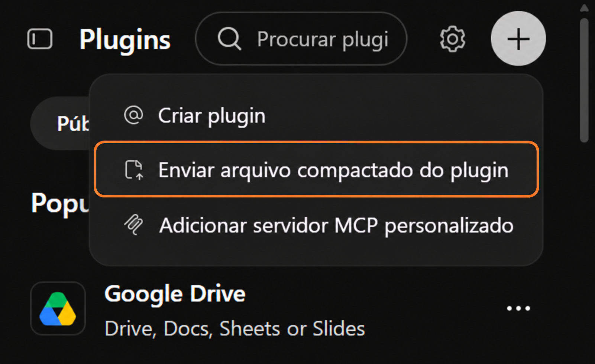
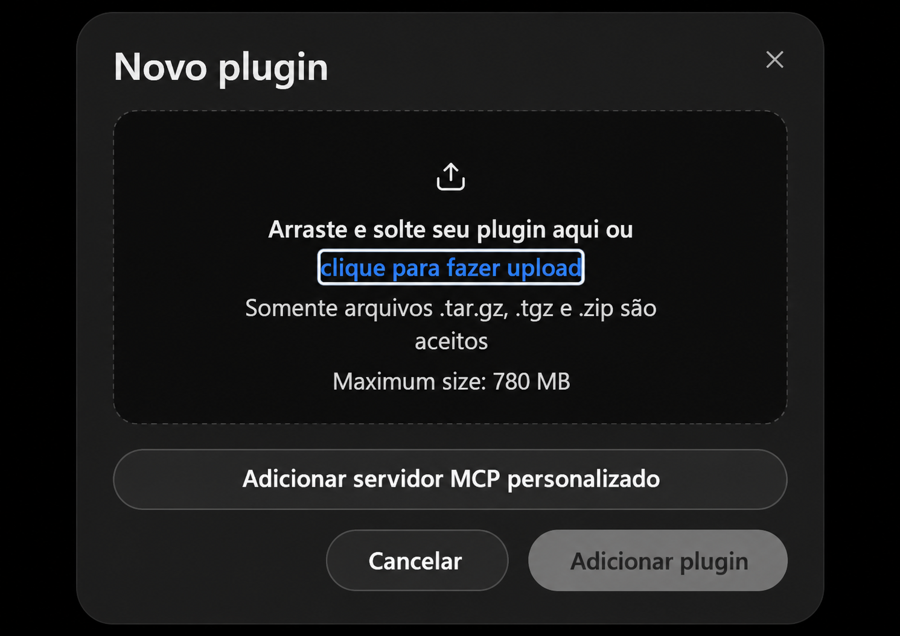
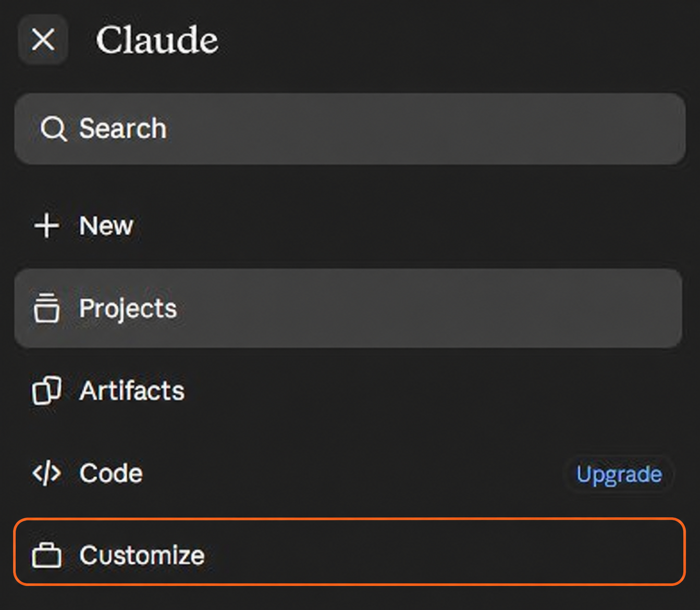
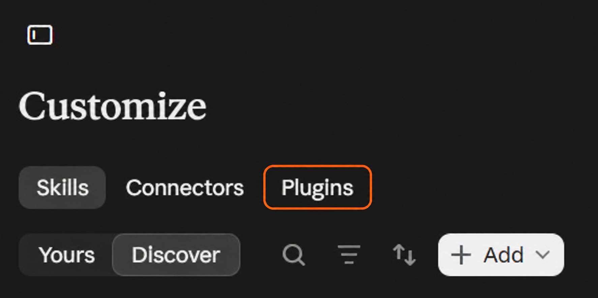
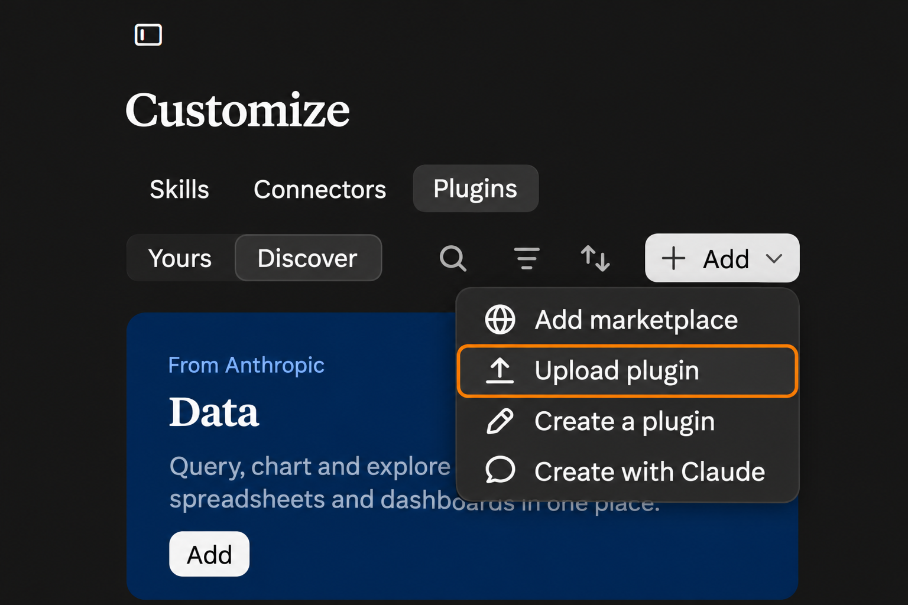
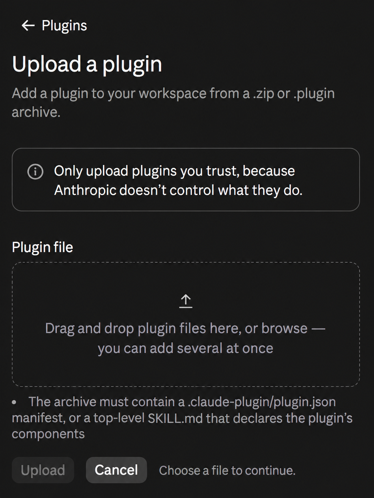

# aiNutri 🥗🥙🍏🍪
Plugin do ChatGPT que ajuda você a **seguir sua dieta**, registrar refeições, controlar calorias e acompanhar seus objetivos!

Envie para o(a) nutri o relatório da sua alimentação com as notas dadas pela IA às suas refeições! 🟢🟡🔴

Em construção

## Como instalar e usar

Primeiro, baixe o arquivo do aiNutri:

1. Acesse a [versão mais recente do aiNutri](https://github.com/andrearanha/aiNutri/releases/latest).
2. Na seção **Assets** (arquivos), selecione **aiNutri.zip** para baixá-lo. Se a lista estiver fechada, toque em **Assets** para abri-la. Escolha **aiNutri.zip**, não os arquivos chamados **Source code**.
3. Guarde o arquivo baixado sem descompactá-lo. Em seguida, escolha abaixo o assistente que deseja usar e siga as instruções.

### Instalar no ChatGPT

1. Abra o [ChatGPT](https://chatgpt.com) no navegador e entre na sua conta.
2. Na barra lateral, abra **Plugins**. Selecione **Adicionar** (o botão **+** no celular) e depois **Enviar arquivo compactado do plugin**.

   

3. Na janela **Novo plugin**, clique em **clique para fazer upload** ou arraste o arquivo `.zip` para a área indicada. Quando o nome do arquivo aparecer, selecione **Adicionar plugin**.

   

4. Depois da instalação, comece uma nova conversa e digite `@aiNutri`. Escolha o plugin na lista e inicie com: **Quero configurar meu acompanhamento alimentar.**

O envio de arquivos compactados pode depender das permissões da conta ou do espaço de trabalho. Se a opção não aparecer, consulte o administrador do espaço de trabalho ou a [ajuda oficial do ChatGPT](https://help.openai.com/en/articles/20001256-plugins-in-chatgpt).

### Instalar no Claude

1. Abra o [Claude](https://claude.ai) no navegador e entre na sua conta. Abra o menu lateral e selecione **Customize**.

   

2. Selecione a aba **Plugins**.

   

3. Selecione **Add** e depois **Upload plugin**.

   

4. Na tela **Upload a plugin**, toque na área **Plugin file**, escolha o arquivo baixado e selecione **Upload**. Aguarde a confirmação do Claude.

   

5. Após a instalação, inicie uma conversa e peça: **Quero usar o aiNutri para configurar meu acompanhamento alimentar.**
